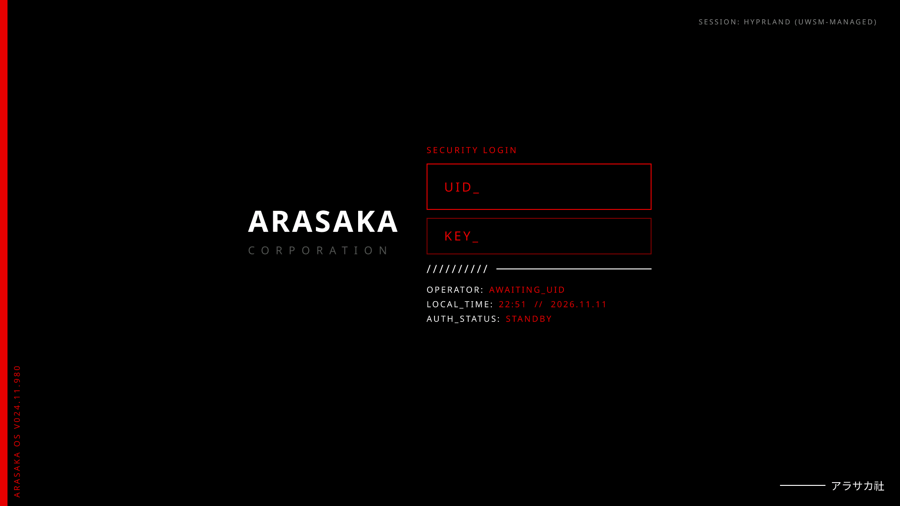

# SDDM Arasaka Theme

A corporate "security terminal" login screen for [SDDM](https://github.com/sddm/sddm) (Qt6), inspired by the Arasaka Corporation from *Cyberpunk 2077*. Pure black background, red accent, boxed `UID_` / `KEY_` fields.



## Features

- Boxed `UID_` and `KEY_` fields, pre-filled with the last user
- Live `OPERATOR` (real name), `LOCAL_TIME` + date and `AUTH_STATUS` readout
- Clickable session switcher, reboot and shutdown
- Scales to any resolution; colours, font and text configurable in `theme.conf`

## Requirements

- Arch Linux (or any distro) with SDDM running on **Qt6**
- Optional: `noto-fonts-cjk` for the Japanese footer text, `imagemagick` for converting your logo

## Install

```bash
git clone https://github.com/aspectZA27/sddm-arasaka-theme.git
cd sddm-arasaka-theme
./install.sh
```

The installer copies the theme to `/usr/share/sddm/themes/arasaka`, makes it the active theme, and disables any conflicting `Current=` line in other SDDM config files (backups are kept as `*.bak-arasaka`).

Preview without logging out:

```bash
sddm-greeter-qt6 --test-mode --theme /usr/share/sddm/themes/arasaka
```

### Manual install

```bash
sudo cp -r arasaka /usr/share/sddm/themes/
printf '[Theme]\nCurrent=arasaka\n' | sudo tee /etc/sddm.conf.d/10-arasaka-theme.conf
```

Make sure no other file (for example `/etc/sddm.conf`) sets `Current=`, since SDDM reads `/etc/sddm.conf` last and it would win.

## Logos (you supply these)

This repo does **not** include the Arasaka logos, because they belong to CD PROJEKT RED. Without them the theme shows a plain-text "ARASAKA / CORPORATION" placeholder. To add your own artwork:

```bash
./install.sh --logo /path/to/logo.png
```

or copy files into `/usr/share/sddm/themes/arasaka/assets/`:

| File | Purpose | Suggested size |
|------|---------|----------------|
| `logo.png` | Main logo, left of the form | about 340x460, transparent background |
| `logo-small.png` | Small logo, bottom right (optional) | about 290x70, transparent background |

Files must be real **PNG** (or JPG/SVG with the path changed in `theme.conf`). AVIF and WebP often won't load in SDDM; `--logo` converts them automatically if ImageMagick is installed.

## Configuration

Edit `/usr/share/sddm/themes/arasaka/theme.conf`:

| Key | Default | Meaning |
|-----|---------|---------|
| `accent` | `#E60000` | Red accent colour |
| `bgColor` | `#000000` | Background colour |
| `fontFamily` | `Noto Sans` | Any installed font family |
| `logo` / `logoSmall` | `assets/logo.png` / `assets/logo-small.png` | Logo paths |
| `versionText` | `ARASAKA OS V024.11.980` | Vertical text on the left edge |
| `formTitle` | `SECURITY LOGIN` | Heading above the fields |
| `footerJp` | `アラサカ社` | Bottom-right footer text |

## Uninstall

```bash
./uninstall.sh
```

## Troubleshooting

- **Theme keeps reverting:** another config file sets `Current=`. Run `grep -rn "Current=" /etc/sddm.conf /etc/sddm.conf.d/` and remove the extras (the installer does this for you).
- **Logo doesn't show:** check `file /usr/share/sddm/themes/arasaka/assets/logo.png` says `PNG image data`.
- **Blank or default screen:** run the preview command above and read the terminal output; Qt5-only SDDM installs won't load a Qt6 theme.

## Disclaimer

This is an unofficial fan project and is not affiliated with or endorsed by CD PROJEKT RED. *Cyberpunk 2077* and Arasaka are trademarks of CD PROJEKT S.A. The code in this repository is released under the MIT license; the license does not cover any third-party logos you add.
